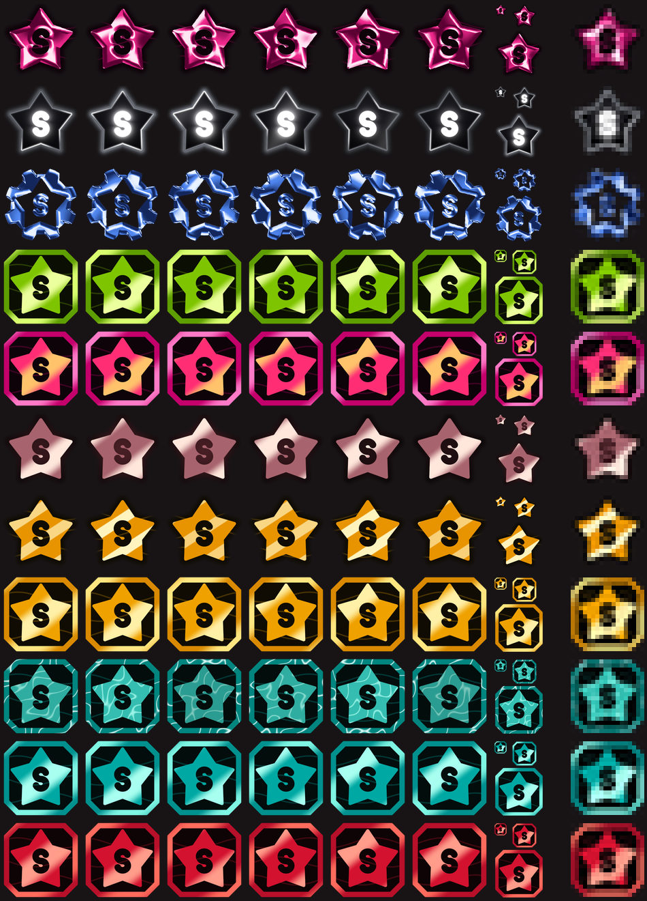

Solrino
============

Solrino is a Twitch chat client for people who are mid-game. It is a fork of [Moltorino7](https://github.com/EEVA-inc/Moltorino), which builds on [Chatterino7](https://github.com/SevenTV/chatterino7) and [Chatterino 2](https://github.com/Chatterino/chatterino2). It supports Twitch, YouTube, Kick and TikTok chat.

### Features of Solrino

- Ping cards with the sender's profile picture, in your chat and on your main monitor.
- A quick game bar above the chat box, with its layout set in the settings.
- Drag the window onto Twitch chat in your browser and it docks exactly over it, follows the browser and shows the same channel.
- Star badges anyone can see on Solrino, which update without a restart.
- Discord activity that shows whether you're modding or chatting. You can turn it off in the settings.
- Choose your own layout in the settings, with a preview before saving.
- First-time setup can import your settings and chat tabs from another fork.
- Automatic updates, with a popup to update now or later.
- Smooth sliding transitions between tabs and settings pages.
- Everything from Moltorino, including YouTube and TikTok accounts, polls and predictions, the theme editor and the vanity menu.

### Badges



### Downloads

Windows builds are on [the Solrino website](https://solrino.solrino-badge-server.workers.dev) and in the [releases section](https://github.com/bloodylungs/Solrino/releases).

### Is Solrino safe?

Yes. Some antivirus apps and Windows warn about it anyway, so here's what's going on:

- **It's open source.** Everything Solrino does is in this repository, so anyone can read it. It builds on Chatterino, which thousands of people have used for years.
- **Why you may see a warning.** The installer isn't signed yet. Signing costs money every year, and without it Windows can't tell who made the file. Each new version is also a brand new file with no reputation yet, and some antivirus apps flag any unsigned installer that unpacks a program. That's a false alarm, not a virus. If Windows shows a SmartScreen warning, click **More info**, then **Run anyway**.
- **It never asks for admin.** Solrino installs only for your own Windows user, in `AppData\Local\Programs\Solrino`. You can remove it any time from **Installed apps** in Windows settings, and your settings are kept in case you come back.
- **How to check your download.** Only download Solrino from [the Solrino website](https://solrino.solrino-badge-server.workers.dev) or the [releases page](https://github.com/bloodylungs/Solrino/releases). Then open PowerShell in the folder you saved it to and run:

  ```powershell
  Get-FileHash .\Solrino-Setup.exe
  ```

  The long code it prints must match the **sha256** code shown next to `Solrino-Setup.exe` on that version's release. You can also upload the file to [VirusTotal](https://www.virustotal.com) to see what every scanner says.

### Issues

If you have issues such as crashes or weird behaviour, report them in [GitHub issues](https://github.com/bloodylungs/Solrino/issues).

### AVIF Support

When building Solrino, you might not have access to a static build of `libavif`. In that case, you can define `CHATTERINO_NO_AVIF_PLUGIN` in CMake.

## Original Chatterino 2 Readme

Chatterino 2 is a chat client for [Twitch.tv](https://twitch.tv).
The Chatterino 2 wiki can be found [here](https://wiki.chatterino.com).
Contribution guidelines can be found [here](https://wiki.chatterino.com/Contributing%20for%20Developers).

## Download

Current releases are available at [https://chatterino.com](https://chatterino.com).
Windows users can also install Chatterino [from Chocolatey](https://chocolatey.org/packages/chatterino).

## Nightly build

You can download the latest Chatterino 2 build over [here](https://github.com/Chatterino/chatterino2/releases/tag/nightly-build)

You might also need to install the [VC++ Redistributables](https://aka.ms/vs/17/release/vc_redist.x64.exe) from Microsoft if you do not have it installed already.  
If you still receive an error about `MSVCR120.dll missing`, then you should install the [VC++ 2013 Restributable](https://download.microsoft.com/download/2/E/6/2E61CFA4-993B-4DD4-91DA-3737CD5CD6E3/vcredist_x64.exe).

## Building

To get the source code, run:

```shell
git clone https://github.com/bloodylungs/Solrino.git
```

The libraries Solrino needs are already in the `lib` folder.

- [Building on Windows](BUILDING_ON_WINDOWS.md)
- [Building on Windows with vcpkg](BUILDING_ON_WINDOWS_WITH_VCPKG.md)
- [Building on Linux](BUILDING_ON_LINUX.md)
- [Building on macOS](BUILDING_ON_MAC.md)
- [Building on FreeBSD](BUILDING_ON_FREEBSD.md)

## Git blame

This project has big commits in the history which touch most files while only doing stylistic changes. To improve the output of git-blame, consider setting:

```shell
git config blame.ignoreRevsFile .git-blame-ignore-revs
```

This will ignore all revisions mentioned in the [`.git-blame-ignore-revs`
file](./.git-blame-ignore-revs). GitHub does this by default.

## Code style

The code is formatted using [clang-format](https://clang.llvm.org/docs/ClangFormat.html). Our configuration is found in the [.clang-format](.clang-format) file in the repository root directory.

For more contribution guidelines, take a look at [the wiki](https://wiki.chatterino.com/Contributing%20for%20Developers/).

## Doxygen

Doxygen is used to generate project information daily and is available [here](https://doxygen.chatterino.com).
